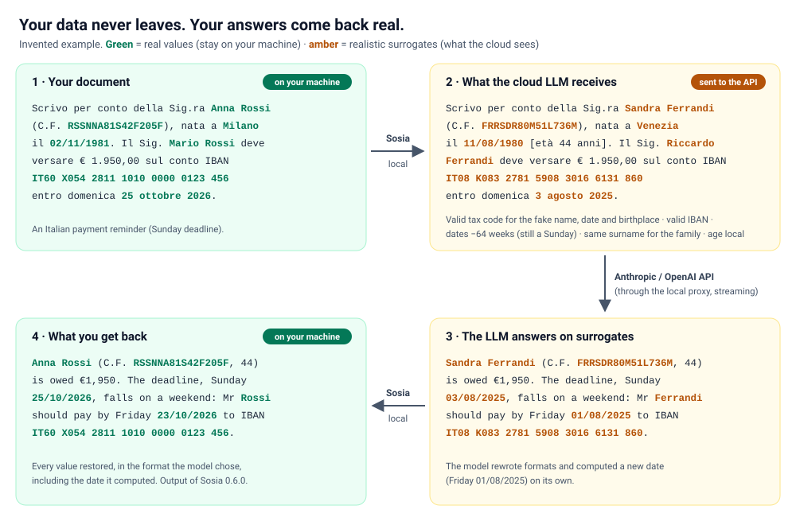

<div align="center">

# Sosia

**Reversible, realistic pseudonymization for LLMs — your data never leaves, your answers come back real.**

[](https://github.com/OWNER/sosia/actions/workflows/ci.yml)
[](LICENSE)
[](pyproject.toml)


*[Leggi in italiano](README.it.md)* · *Sosia* is Italian for "look-alike, double".

</div>

Sosia sits between you (or your app) and a cloud LLM. Before a request leaves your machine it replaces personal data
with **realistic, internally consistent surrogates**; when the answer comes back it **puts the real data back** —
streaming included. The model reads a document that still makes sense (valid tax codes, valid IBANs, the same person
always called the same way, the same timeline), not a page full of `[PERSON_1]`.



## Why Sosia

- **Realistic surrogates instead of `[REDACTED]`.** Names, places, codes and dates are replaced with plausible values of
  the same kind and format, so the LLM can still reason about the document. One alias per first name and per surname
  keeps "Mario Rossi", "ROSSI MARIO", "M. Rossi" and "Rossi's" consistent, and family members share the fake surname.
- **Valid and mutually consistent codes.** The fake Italian *codice fiscale* is rebuilt from the fake name, the same sex,
  the shifted birth date and the cadastral code of the fake birthplace; IBANs (Italian CIN + mod 97) and *partita IVA*
  have valid check digits; US SSN/ITIN, UK NHS and National Insurance numbers and ABA routing numbers keep valid formats
  and checksums.
- **Dates shifted by whole weeks.** Every date in a session moves by the same number of weeks: order, intervals and
  weekdays are preserved (a Sunday deadline is still a Sunday). References to laws and decrees are left untouched.
- **Ages and deadlines computed locally — "today" is never disclosed.** Sosia annotates ages before sending and lets the
  model write markers (`⟦OGGI⟧`, `⟦ETA:…⟧`, `⟦SCADENZA:…⟧`) that are computed on your machine, so the provider cannot
  derive the date shift from the time of the request.
- **Byte-for-byte round trip, checked automatically.** Every outgoing text is restored locally without the model and
  compared with the original; anything that would not come back identical is sent as a reversible placeholder instead.
  On the way back Sosia also handles rewritten aliases, initials, changed formats and dates the model computed itself;
  uncertain spots are reported, never guessed.
- **Streaming.** The restorer holds back only a short tail, so a value never leaves half-restored: identical output on
  320/320 documents cut into random 1–12-character chunks.
- **Drop-in proxy for Anthropic and OpenAI APIs.** Point `ANTHROPIC_BASE_URL` or `OPENAI_BASE_URL` at it:
  `/v1/messages`, `/v1/chat/completions` and `/v1/responses`, with SSE streaming and tool-call arguments.
- **Documents, not just strings.** TXT, Markdown, CSV, JSON, **DOCX** and **XLSX** edited in place (styles, tables,
  formulas and date cells kept), **PDF** (text output) and **email** (`.eml`, attachments included).
- **Everything local.** CPU only, optional NER model loaded from disk, no telemetry. The real↔fake map never leaves your
  machine: it is encrypted (AES-256-GCM, key protected with Windows DPAPI or derived with scrypt) and expires.
- **Italian + English (US and UK).** Language detected per text, US/UK date convention detected per document, mixed
  Italian–English documents supported; official name and place lists (ISTAT, OS Open Names, ONS, US Census, Wikidata).
- **A few milliseconds per chat message.** +5–11 ms to the first token on short messages, about +0.1 s on a first
  request with an 80,000-character context (CPU, measured through the proxy).

## How it compares

Facts checked on public documentation in October 2026. "—" means not offered or not found in the public docs.

| | **Sosia** | [Presidio](https://github.com/data-privacy-stack/presidio) (+ [LiteLLM](https://docs.litellm.ai/docs/proxy/guardrails/pii_masking_v2)) | [LLM Guard](https://github.com/protectai/llm-guard) | [Limina (Private AI)](https://docs.private-ai.com/introduction) | [Tonic Textual](https://docs.tonic.ai/textual/dataset-files/dataset-file-types.md) | [OpenMed](https://github.com/maziyarpanahi/openmed) | [Latet](https://github.com/Latet-AI/latet) |
|---|---|---|---|---|---|---|---|
| Replacement | realistic surrogates with valid checksums | placeholders, hash, mask, encrypt (custom operators possible) | placeholders, or Faker values | placeholders or synthetic (beta) | synthetic or redaction | placeholders, hash or Faker surrogates | same-shape fakes |
| Italian codice fiscale consistent with fake name, date and place | **yes** | detected, not synthesised | — | — | — | random CF | detected |
| Reversible | **yes**, robust to model rewrites | via encrypt/decrypt; LiteLLM restores placeholders | yes (vault) | — | — | surrogate vault | yes |
| Date shifting | **whole weeks** (weekdays kept) | — | — | — | yes, in days | yes, in days (per patient) | — |
| "Today", ages, deadlines computed locally | **yes** | — | — | — | — | — | — |
| LLM API proxy with streaming | **yes** (Anthropic, OpenAI, tool calls) | via LiteLLM | — | — | — | — | yes (coding agents) |
| File formats | txt, md, csv, json, docx, xlsx, pdf (text), eml | text, structured data, images | text | text, PDF, images, audio | widest (docx, xlsx, pdf, pptx, images, eml…) | documents | PDFs flagged or blocked |
| OCR / images | — | **yes** | — | **yes** | **yes** | — | — |
| Languages | Italian, English (US/UK) | many | English, Chinese | 50+ | 50+ | 35 | several |
| Licence | Apache-2.0 | MIT | MIT (archived) | proprietary | proprietary | Apache-2.0 | Sustainable Use (not OSI) |
| Runs fully on your machine | **yes**, CPU | yes | yes | on-prem container (paid) | — | yes | yes |

Where others are ahead: Presidio, Limina and Tonic handle OCR, images and many more languages; OpenMed covers
35 languages for clinical text; Presidio and LiteLLM are mature and widely deployed. Sosia's niche is high-fidelity,
reversible surrogates for Italian and English documents in front of LLM APIs.

## Quickstart

```bash
git clone https://github.com/OWNER/sosia.git && cd sosia
pip install -e ".[proxy,pdf,xlsx]"
python examples/quickstart.py
```

No model and no network needed: the rules alone handle codes, dates, addresses and most names. Python 3.11+.
Windows is the reference platform; on Linux and macOS set `SOSIA_PAROLA` to a passphrase for the encrypted map.

### Python

The API is in Italian (*pseudonimizza* = pseudonymise, *ripristina* = restore, *sessione* = session, *testo* = text).

```python
from sosia import Sessione

s = Sessione()                                  # one session = one consistent map
fake = s.pseudonimizza(document)                # fake.testo goes to the cloud
answer = call_your_llm(fake.testo, system=s.istruzioni_oggi())
real = s.ripristina(answer)                     # real.testo; real.incerti = spots not restored with certainty

f = s.flusso()                                  # streaming restore
for chunk in stream:
    print(f.scrivi(chunk), end="")
print(f.chiudi())
```

### Proxy (Anthropic and OpenAI SDKs, CLI agents)

```bash
sosia proxy --porta 8787                          # add --ner gliner for the optional local NER model
export ANTHROPIC_BASE_URL=http://127.0.0.1:8787   # Windows: set ANTHROPIC_BASE_URL=...
export OPENAI_BASE_URL=http://127.0.0.1:8787/v1
```

```python
import anthropic

client = anthropic.Anthropic(base_url="http://127.0.0.1:8787")   # your API key is forwarded untouched, never stored
r = client.messages.create(model="claude-sonnet-4-5", max_tokens=800,
                           messages=[{"role": "user", "content": "Summarise this letter:\n" + letter}])
print(r.content[0].text)                                           # real names, codes and dates are back
```

The proxy listens on 127.0.0.1 only and rejects browser `Origin`s and foreign `Host`s. Images are blocked by default
(`--immagini lascia` lets them through unprotected); base64 PDFs are converted to pseudonymised text. `--date nascita`
shifts only birth dates, for agents that work with real calendars. More in [examples/](examples/).

### Command line and files

```bash
sosia pseudonimizza contratto.docx --sessione case-42          # -> contratto.finto.docx
sosia ripristina risposta.md --sessione case-42                # real data back
sosia pseudonimizza referto.pdf --fuga                         # "leak-proof" mode: replace when in doubt
sosia sessioni --pulisci                                       # delete expired maps
```

### Optional local NER (GLiNER)

The model is not in this repository and Sosia never downloads anything at run time. Fetch it once, on purpose:

```bash
pip install -e ".[ner-gliner]" huggingface_hub
python scripts/download_models.py        # urchade/gliner_multi_pii-v1 (Apache-2.0) + mdeberta-v3-base tokenizer (MIT)
sosia proxy --ner gliner
```

GLiNER runs on CPU (about 1.2 GB, ~15 s to load in the background) and adds rare and foreign names the rules do not
know. In the proxy it only runs on sentences with unknown capitalised words.

## Benchmark

All test documents are invented. They were written by independent authors (LLM-generated, each with its own list of
expected entities) who never saw the code; before use each set is hashed and encrypted so it cannot be read during
development, and it is measured **once**. Rules are tuned only on sets already used.

**Sosia 0.6.0, final set of 80 unseen documents** (40 Italian, 40 English US/UK), rules + GLiNER "auto":

| Measure | Result |
|---|---|
| Exact round trip (byte for byte) | **80/80** |
| Restore after a simulated model rewrite | **99.7%** (644/646), no alias left behind |
| Codice fiscale, IBAN, partita IVA, e-mail | **100%** (24/24, 23/23, 12/12, 55/55) |
| Phone numbers | 98.4% (124/126) |
| All codes and patterns | 97.1% (430/443) |
| First names and surnames | **96.5%** (655/679): Italian 94.7%, English 98.4% |
| Places and addresses (set built around rare places) | 79.5% (605/761) |
| Precision | 92.1% |
| Timeline (every date read and shifted exactly) | 89.2% |

**Quality with a real model.** Three documents summarised by Claude with and without Sosia (9 calls): after restoration
the summaries got 16/16 surnames and 20/20 dates right, against 16/16 and 19/20 without the shield.

**Latency** (CPU, streaming, added time to the first token, median of 5 runs):

| Case | Added |
|---|---|
| Short chat message | +5–11 ms |
| First request with an ≈80,000-character context | +109 ms |
| 2,500-character document | +55 ms |
| 23,700-character PDF | +435 ms |
| Streaming restore of a 6,000-character answer | ~5 ms per chunk |

The final set was deliberately hard on places (tiny hamlets, Welsh and Gaelic house and farm names, US counties and
rural routes): that is where Sosia is weakest today. See the limitations below.

## Roadmap and known limitations

Sosia **reduces** what a cloud provider sees; it is pseudonymisation, **not** anonymisation, and not a compliance
guarantee. The full, honest list is in [docs/LIMITATIONS.md](docs/LIMITATIONS.md) ([italiano](docs/LIMITI.md)). In short:

- What is not detected is sent in clear (see the numbers above): for sensitive documents use `--ner gliner --fuga` and
  review the pseudonymised text before sending.
- Context can still identify people (a rare job, a small village, a unique event).
- One date shift per session: knowing a single real date reveals all of them.
- Vague time expressions ("end of the quarter", "spring") and very old years can stay in clear.
- No OCR: scanned PDFs and images are not handled; PDF output is text only.
- The local map is readable by anyone who controls your user account.
- Windows is the reference platform; Linux and macOS use the scrypt vault and are less tested.
- Code identifiers and comments are in Italian.

Next on the roadmap: rare places (UK house and farm names, Welsh and Gaelic toponyms, rural US addresses), more date
expressions, a PyPI package, an English API alias layer, integrations with Presidio and LiteLLM, and more languages.
Design notes (Italian): [docs/DESIGN.md](docs/DESIGN.md).

## Use cases

- **Law firms** — letters, claims, contracts and court documents: names, tax codes, IBANs and case numbers stay on
  your machine, while the model still computes deadlines that come back as real dates.
- **Healthcare** — discharge letters and clinical notes: patients, relatives and doctors replaced, dates shifted
  consistently so the clinical timeline survives; diagnoses are flagged but kept by default (changing them confuses the
  model). A support tool, not a medical device.
- **HR and payroll** — payslips and employee spreadsheets in XLSX: names, tax codes, IBANs and birth dates replaced in
  place, formulas and formatting kept.
- **Accountants and tax advisers** — invoices, tax letters, bank statements: valid VAT numbers and IBANs, consistent
  people and companies across a whole session.

## Contributing

Issues and pull requests are welcome, in English or Italian. Please never include real personal data — not in code,
tests, issues or logs. See [CONTRIBUTING.md](CONTRIBUTING.md) and, for vulnerabilities, [SECURITY.md](SECURITY.md).
If Sosia is useful to you, a ⭐ helps others find it.

## License

[Apache-2.0](LICENSE). Third-party data and models: [NOTICE](NOTICE) (ISTAT CC BY 4.0, OS and ONS under the Open
Government Licence v3.0, US Census public domain, Wikidata CC0; GLiNER Apache-2.0 and mDeBERTa MIT, not included).
